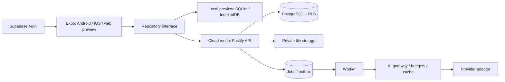
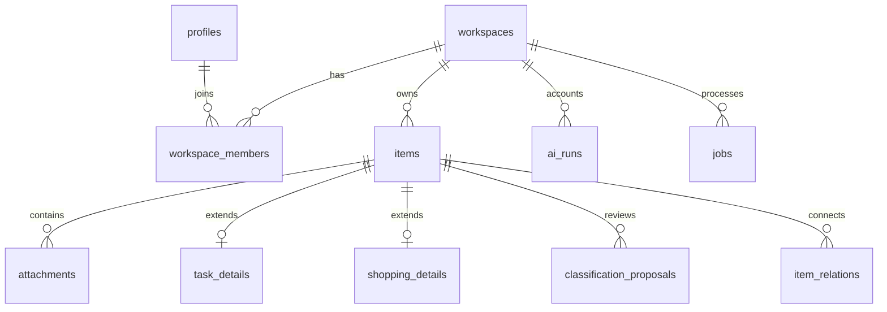

# LIFE OS — архитектура и границы первой версии

Дата: 2 ноября 2026. Статус: стек согласован; порядок реализации обновлён по прямому указанию пользователя, начата разработка.

## Изменение приоритетов, согласованное пользователем

Главный принцип — минимальная нагрузка на пользователя, а не минимальное количество функций. Обычный органайзер работает без AI; интеллектуальная помощь подключается к тому же хранилищу. Текст ниже читается с учётом обновлённого порядка этапов в разделе 10.

Карточки `movie`, `recipe`, `product` становятся первыми типизированными расширениями общей сущности: фильм (catalog id, название, год, описание, poster, рейтинг с источником, trailer URL, статус просмотра), рецепт (порции, ингредиенты с количеством/единицей, шаги, источник, необязательные оценочные nutrition), товар (бренд, модель, ссылки, цена в minor units/currency с датой и источником). Неизвестные поля остаются пустыми, AI не придумывает их. До внешних интеграций карточки можно заполнять вручную. Медиа-каталог не смешивается с пользовательским статусом просмотра.

Ранний AI запускается до полного облака через отдельный Fastify gateway. Локальное хранилище не означает локальное хранение provider key. Прототип: закрытая серверная allowlist пользователей/устройств, короткоживущие отзываемые токены с областью `recognize`, pair flow с одноразовым секретом, TLS вне localhost, rate limiting по пользователю и IP, ограниченные MIME/размер/пиксели, timeout, атомарный учёт резерва и фактической стоимости. Долгоживущий общий токен нельзя зашивать в приложение или EXPO_PUBLIC. До появления сессии endpoint отклоняет запрос; одного CORS недостаточно. Затем этот auth adapter заменяется проверкой Supabase JWT без изменения recognition contract.

Каждый AI-запрос привязан к request id, владельцу и content hash. Изображение отправляется только после явного действия, EXIF удаляется при подготовке; ограниченное временное хранение с очисткой. При недоступном gateway, квоте или ошибке распознавания пользователь сохраняет оригинал и продолжает вручную. Никаких демонстрационных AI-ответов.

Первый полный AI-сценарий: скриншот → vision возвращает кандидата фильма и признаки неопределённости → пользователь подтверждает/исправляет → backend ищет кандидатов во внешнем каталоге → пользователь выбирает точное совпадение → backend получает details/videos → сохраняется типизированная карточка с provenance. TMDB — начальный кандидат через server adapter; нужен отдельный API token, обязательная атрибуция и проверка условий коммерческого использования. Трейлер выбирается из доступных video records с доверенным site/key; если отсутствует, показывается «трейлер отсутствует», а не придуманная ссылка. Каталожные запросы не оплачиваются как LLM, но также ограничиваются и кэшируются. Нет автоматического выбора первого результата при неоднозначности.

Входящее системное «Поделиться» проверяется рано параллельно с gateway. Официальный expo-sharing предоставляет receive API и config plugin, но функция экспериментальная; plugin меняет Android intent filters и добавляет iOS Share Extension. Нужен development/production build, Expo Go не доказывает работоспособность расширения. Документация отдельно предупреждает о способе открытия main target на iOS, который официально Apple не поддерживается. До device spike не обещаем production-пригодность; при проблемах оцениваем отдельный native extension/поддерживаемый adapter. Любой shared URI копируется в постоянное хранилище до подтверждения импорта; payload очищается лишь после успеха, повторный launch не дублирует импорт. URL и текст проходят те же правила, что ручной ввод.

Домашние шаблоны — локальные данные RU/UK/EN, а не AI: быстрая уборка, еженедельная уборка и сезонные дела. Пользователь предварительно видит задачи, затем добавляет выбранный шаблон одной транзакцией; повторное применение не создаёт незаметных дублей. Редактирование и завершение обычные.

Техническая проверка отдельным reviewer завершена: существенных пробелов, препятствующих планированию, не обнаружено. Это проверка документа, не проверка работающего приложения.

## 1. Контекст и принятые решения

LIFE OS — персональный помощник, который превращает входящую информацию в доступные для поиска материалы и подтверждённые действия. Главный сценарий: сохранить → получить предложение → подтвердить или исправить → найти и использовать позже.

Проверка окружения: рабочая папка — `D:\`; в корне нет проекта LIFE OS и AGENTS.md. Просмотрены названия каталогов и маркеры проектов на один уровень ниже; существующие сторонние проекты не изменялись. Это не утверждение об отсутствии кода на всём диске. Пользователь явно выбрал новый проект `D:\life-os` на React Native + Expo и TypeScript backend.

Обнаружены Node.js 24.22.1 и Git 2.56.0 в поставляемом окружении Codex. Наличие Android SDK, Xcode, Docker, PostgreSQL и готового облачного проекта пока не подтверждено. На Windows нативную iOS-сборку следует проверять через macOS/облачную сборку и реальное устройство; запуск веб-версии не заменяет эту проверку.

### Рассмотренные подходы

| Подход | Преимущества | Ограничения | Решение |
| --- | --- | --- | --- |
| React Native + Expo, TypeScript API, PostgreSQL | Один язык клиента и сервера; мобильные мультимедиа; возможность веб-клиента | Нативные разрешения и сборки требуют отдельной проверки; UI не полностью общий с будущим desktop web | Выбран пользователем |
| Flutter + TypeScript API | Сильная мобильная UI-модель | Дополнительный язык Dart; меньше общего кода с TypeScript backend | Не выбран |
| Web/PWA сначала | Быстрая браузерная доставка | Хуже проверяет мобильный захват, расширения Share и фоновые сценарии | Не выбран как основная платформа |

Далее описаны предложения архитектора; выбор стека не означает автоматического согласования всех деталей этого документа.

## 2. Цели и границы

Цели первой версии:

- Единый Inbox для текста, HTTP(S)-ссылок и пользовательских изображений.
- Подтверждение предложенной категории до изменения предметных разделов.
- Рабочие задачи, покупки/желания и сохранённые материалы.
- Единый поиск, просмотр, редактирование, выполнение и удаление.
- Сохранность информации после перезапуска, RU/UK/EN, светлая и тёмная темы.
- Обычные операции без LLM; прозрачный статус доступности AI.

Антицели: декоративный чат, фиктивное распознавание, пустые кнопки, десять разрозненных каталогов, обязательная AI-подписка для CRUD, скрытая отправка личных данных провайдеру.

За пределами фундамента: медицинские данные и рекомендации, анализ составов, видео/аудиотранскрипция, отслеживание цен, маршруты, семейный доступ, платежи, offline-синхронизация. AI vision и каталог фильмов идут сразу после фундамента, до полного облака.

## 3. Состав системы

Рекомендуется модульный монолит, а не микросервисы: один API, отдельный процесс worker, PostgreSQL, приватное объектное хранилище. Границы модулей позволят выделять сервисы по измеренной нагрузке.



### Клиент

Expo + React Native + TypeScript, Expo Router, общий пакет DTO/валидации. TanStack Query для серверного состояния в облачном режиме; настройки интерфейса — небольшой локальный store. Формы не требуют отдельного глобального состояния.

На iOS/Android локальный адаптер использует expo-sqlite и постоянную директорию файлов. В веб-превью — IndexedDB с данными вложений, а не localStorage для изображений. В foundation байты картинки сохраняются как data URL внутри item row; отдельные Blob records можно ввести миграцией при росте объёмов. Storage поведение проверяется отдельно; Node SQLite не заменяет проверку Expo на телефоне. На native файл копируется из временного picker URI до подтверждения успешного сохранения.

Первая поставка — явно обозначенный локальный режим одного устройства, без аккаунта и синхронизации. Затем ранний закрытый AI gateway и movie flow; далее облачный режим. Не разрешать произвольную смену repository поверх существующих данных: перенос — отдельный идемпотентный импорт после входа с проверкой владельца.

### Сервер и инфраструктура

- Node.js LTS, Fastify, TypeScript; JSON Schema/TypeBox для контрактов и серверной валидации.
- PostgreSQL; SQL-миграции под версионным контролем, Drizzle как типизированный слой доступа.
- Supabase Auth для первого облачного релиза, проверка JWT по JWKS на API. Собственную парольную авторизацию не писать.
- Supabase PostgreSQL и private Storage как стартовая управляемая инфраструктура. Доменные сервисы зависят от интерфейсов, а не Supabase SDK.
- Worker с PostgreSQL-очередью: lease, retry, backoff, dead-letter status. Redis не обязателен на MVP.
- Docker Compose для локального API/PostgreSQL; облачная авторизация и storage настраиваются отдельно. Локальный режим приложения работает без Docker, AI-ключей и облачной учётной записи.
- Версии Expo/RN выбирать совместимым набором через Expo tooling, закреплять lockfile. Не смешивать произвольные последние версии пакетов.

## 4. UX и основные сценарии

Нижняя навигация: «Сегодня», «Inbox», «Пространства», «Поиск». Настройки открываются через профиль. На широком экране — боковая навигация с теми же маршрутами.

«Сегодня»: приветствие без обязательного имени, поле «Что сохранить или сделать?», ближайшие незавершённые задачи, короткий список актуальных покупок. Нет выдуманных рекомендаций и демонстрационных записей в пользовательском хранилище.

Inbox: текстовое поле, прикрепление изображения, сохранение ссылки из текста. После сохранения карточка уже существует в Inbox, даже если классификация не состоялась. Пользователь видит источник предложения: «по правилу», «AI» или «категория не определена». При нескольких подходящих правилах остаётся Inbox с выбором категории. У правил нет вымышленного процента уверенности.

Подтверждение: категория, заголовок, необязательное описание, срок с часовым поясом для задачи. Изменение категории доступно вручную. Кнопка «Подтвердить» создаёт/обновляет связанный объект ровно один раз. Исправление не запускает платное распознавание повторно.

Пример: «Нужно купить корм коту» → предложение «Покупки» по правилу покупки → пользователь подтверждает → запись появляется в покупках и общем поиске. Из этого текста не создаются одновременно и покупка, и задача. Дополнительную задачу пользователь создаёт отдельным явным действием.

Непонятная ссылка сохраняется как материал с исходным URL. Изображение без AI сохраняется с ручным названием и категорией; интерфейс сообщает, что содержимое не распознано. Слова «AI распознал» в таком состоянии запрещены.

Задачи: создание, изменение, завершение/возврат, срок, приоритет, фильтры. Покупки: название, количество, единица, ссылка, статус «нужно/куплено». Материалы: текст, ссылка, вложения, категория/теги. Отдельные папки пользователь создавать не обязан.

Поиск использует сохранённый текст и метаданные. До OCR изображения доступны по введённому названию; нельзя обещать поиск по нераспознанным пикселям. Пустые состояния, загрузка, ошибки сохранения, отсутствие результатов и отказ в разрешениях имеют отдельные состояния.

Микрофон, импорт видео, отправка push и внешние каталоги не показываются как активные возможности до реализации. Доступность определяется capabilities. Поле секретаря в первом срезе принимает информацию в Inbox; сложный диалог доступен только после подключения AI, с явным обозначением режима.

Дизайн: спокойные нейтральные поверхности, один акцент, карточки со скруглениями, чёткая типографика; никаких плотных таблиц на главном экране. Учесть safe areas, клавиатуру, экранные дикторы, увеличение шрифта и контраст. Все строки вынесены в словари RU/UK/EN, включая ошибки, даты и множественные формы.

## 5. Единая предметная модель

Inbox — этап обработки, а не самостоятельная копия пользовательских данных. `items` — общая сущность с типизированными расширениями. Пространство/категория и тип сущности — разные понятия: задача может относиться к дому, а покупка — к уходу.

Категории: general, home, work, shopping, entertainment, food. Типы: note, link, image, task, shopping_item, movie, recipe, product. Файл — attachment, а не обязательный тип родителя. Облачные movie_details, recipe_details/ingredients/steps и product_details используют составные workspace FK; внешние catalog_entries отделены от пользовательского статуса.



### Таблицы облачной модели

| Таблица | Основные поля и ограничения |
| --- | --- |
| `profiles` | `id = auth subject`, display_name, locale, IANA timezone; медицинских полей нет |
| `workspaces` | id, owner_id, kind personal/family; family не включён в первом релизе |
| `workspace_members` | workspace_id, user_id, role; unique пара; доступ в MVP только к personal workspace |
| `items` | id UUID, workspace_id, created_by, kind, category, title, body, source_url, inbox_status, version, created_at, updated_at, deleted_at |
| `task_details` | item_id unique, workspace_id, due_at UTC nullable, timezone, priority, completed_at; recurrence появится отдельной миграцией |
| `shopping_details` | item_id unique, workspace_id, quantity numeric > 0, unit, purchased_at, optional amount_minor и currency; денег в float нет |
| `attachments` | id, workspace_id, item_id, storage_key, MIME, byte_size, sha256, status, created_at; временные URI не сохранять как конечные |
| `classification_proposals` | id, workspace_id, item_id, input_version, proposed_kind/category, extracted_fields JSONB, source rule/ai, schema_version, status, expires_at |
| `item_relations` | workspace_id, from_item_id, to_item_id, relation_type; обе стороны внутри одного workspace |
| `jobs` | id, workspace_id, item_id nullable, type, state, dedupe_key, attempts, available_at, lease_until, last_error_code; без контента в ошибках |
| `ai_runs` | id, workspace_id, user_id, operation, provider/model, input_hash, tokens, reserved/actual micro-USD, status, provider_request_id; контент отдельно не логируется |
| `ai_cache` | workspace_id, cache_key, result JSONB, schema/model/prompt versions, expires_at; персональный cache не общий между пользователями |
| `plans`, `plan_limits` | versioned тарифы, лимиты операций/вложений/хранилища; числа задаются конфигурацией, а не обещанием в UI |
| `subscriptions`, `usage_periods` | workspace_id, plan_version, status, UTC period, reserved/consumed units; платежного checkout пока нет |
| `idempotency_keys` | workspace_id, actor_id, route, key, request_hash, response, expires_at; unique scope/key |
| `audit_events` | actor, workspace, action, object_id, timestamp; без исходного текста и медицинского содержимого |

Ссылки дочерних таблиц используют составные FK `(workspace_id, item_id)` → `items(workspace_id, id)`, чтобы чужой объект нельзя было прикрепить даже при ошибке сервиса. Typed-расширение обязано соответствовать kind; изменения kind выполняются одной транзакцией с обновлением/удалением расширений.

Общие ограничения: ненулевой workspace_id у пользовательских объектов; длины строк и лимиты вложений; серверное время; optimistic concurrency по version. `PATCH` со старой версией получает 409 и не перетирает правки.

Индексы: `(workspace_id, updated_at, id)`, `(workspace_id, inbox_status, created_at)`, сроки незавершённых задач, GIN для поискового документа; unique для idempotency и дедупликации заданий. Сортировка/пагинация по стабильной паре timestamp/id.

Локальная схема сохраняет UUID и названия общих полей. Единственный local workspace создаётся без имитации облачной учётной записи. Схема имеет версию и миграции. Первая версия не обещает шифрование всей локальной БД; чувствительные медицинские данные в неё не добавляются.

Поиск: в PostgreSQL FTS + GIN; `simple`-конфигурация как общая база RU/UK/EN, нормализация регистра и поддержка частичного поиска по заголовку. Морфология украинского и опечатки требуют отдельной оценки, не обещаются автоматически. На local adapters — параметризованные запросы/эквивалентная безопасная фильтрация для небольшого личного набора; поведение зафиксировано тестами. Embeddings в MVP не нужны.

## 6. Жизненный цикл Inbox

1. Валидировать текст/URL/файл, ограничения и активный workspace.
2. Записать `items` со статусом `unprocessed`; исходный ввод сохранить до любой обработки.
3. Файл сохранить в постоянное хранилище, затем attachment перевести из `pending` в `ready`. При сбое оставить карточку с возможностью повторить/удалить вложение; не показывать ложный успех.
4. Применить версионированные правила RU/UK/EN. Они предлагают, но не исполняют действие. Неоднозначные даты не угадывать.
5. При явном запросе пользователя и доступном AI создать job/запрос с бюджетом. Без провайдера статус `provider_unavailable`, карточка доступна для ручного выбора.
6. Результат проходит JSON Schema; предложение сохраняется отдельно от пользовательской сущности и привязано к input_version.
7. При подтверждении сервер/локальная транзакция проверяет версию, применяет kind/category и расширения, переводит inbox_status в `confirmed`. Повторное подтверждение идемпотентно. Устаревшее предложение получает 409 и требует пересмотра.
8. Пользователь может вернуть объект в Inbox или исправить его вручную. Повторное AI-действие — отдельное явное действие.

Состояние файла, job и Inbox не смешивать в один enum: успешно сохранённая заметка может иметь ошибку обработки картинки. Для UI используются независимые статусы и понятное следующее действие.

## 7. Экономичная AI-архитектура

Детерминированно: CRUD, фильтры, сортировка, даты из date picker, поиск, списки, завершение задач, подтверждение категорий, пересчёт количества. Никаких LLM-вызовов по таймеру, при каждом рендере, при вводе каждого символа или просто при открытии главного экрана.

AI: сложная классификация, извлечение структуры, OCR/vision и планирование — через capability и явное действие. Сразу после фундамента, до полного облака, вводятся text extraction и vision-сценарий фильма. Без ключа работает ручной режим и правила.

Gateway принимает operation, actor/workspace, нормализованный ввод, schema_version, max_output_tokens и deadline. Provider interface возвращает validated data, usage, provider_request_id и нормализованную ошибку. Отдельные адаптеры позволяют менять поставщика; provider-specific SDK не импортируется доменными модулями. URL провайдера задаётся администратором backend, не пользователем.

Порядок выполнения: проверка прав → правила → workspace-scoped cache → атомарная резервация квоты и верхней денежной оценки → вызов → проверка схемы → фиксация фактического расхода/освобождение остатка. При конкурентных запросах нельзя превысить квоту двойной проверкой вне транзакции.

Ключ cache: workspace + operation + нормализованный content hash + prompt/schema versions + provider/model + relevant locale. Срок жизни ограничен. Cache не переносит персональные результаты между пользователями; удаление исходного контента инвалидирует зависимые результаты. Изменившиеся цены и внешние сведения имеют отдельный короткий TTL в будущих интеграциях.

Стоимость хранится целым числом micro-USD, тариф модели — версионированный server config. Ограничения: размер ввода/изображения, число изображений, токены вывода, deadline, месячная квота, денежный предел пользователя и глобальный предел проекта. В UI до запуска показывается расход квоты; реальные денежные показатели доступны административно.

Retry только для временных ошибок с ограниченным числом попыток и backoff. После неясного timeout нельзя автоматически считать вызов бесплатным или безусловно повторять платный запрос. Резерв остаётся в состоянии reconciliation; повторение учитывает риск повторной оплаты и возможности provider idempotency. Клиентский повтор не запускает вторую операцию благодаря request key.

Вложения и сохранённые страницы — недоверенные данные, а не инструкции. AI не получает ключи, SQL или прямой доступ к БД. Разрешённые инструменты: searchItems, getItem, listTasks и подготовка proposal. Область доступа вычисляет backend из сессии, а не из model arguments.

Секретарь читает только разрешённые записи; выдаёт ссылки на конкретные карточки. Новый план — предложение. Массовые изменения, удаление, публикация, семейное расшаривание, внешние действия и медицинские решения автоматически не исполняются. Подтверждение привязано к точному payload, actor, version и сроку, одноразовое; изменение предложения обнуляет согласование.

## 8. API и структура проекта

Версия API `/v1`, JSON DTO, cursor pagination, единый error envelope `{code, messageKey, requestId, details?}`. Не выдавать внутренний stack trace. AI/долгие операции возвращают 202 с operation id; polling останавливается при terminal state и не вызывает модель повторно.

| Endpoint | Назначение |
| --- | --- |
| `GET /health`, `GET /ready` | Живость процесса и готовность зависимостей, без секретов |
| `GET /v1/me`, `PATCH /v1/me` | Профиль, язык, timezone |
| `GET /v1/capabilities` | Реально включённые возможности и доступные квоты |
| `POST /v1/inbox` | Сохранить ввод, Idempotency-Key |
| `GET /v1/inbox` | Входящие и статусы |
| `POST /v1/items/:id/classify` | Явно запросить AI; quota reservation |
| `POST /v1/proposals/:id/confirm` | Подтвердить точную версию предложения |
| `GET/POST /v1/items`, `GET/PATCH/DELETE /v1/items/:id` | Общие объекты; DELETE через контролируемое удаление |
| `POST /v1/items/:id/complete` | Идемпотентное задание completed=true/false, не неявный toggle |
| `GET /v1/search?q=...` | Поиск в активном workspace |
| `POST /v1/attachments/init`, `POST /v1/attachments/:id/finalize` | Ограниченная загрузка и проверка фактического файла |
| `GET /v1/operations/:id` | Статус обработки своего workspace |
| `GET /v1/usage` | План, период, consumed/reserved quota |

API не считается готовым только по наличию этих названий: каждый endpoint проходит интеграционную проверку. Авторизацию делегируем Auth SDK; backend собственного login/password endpoint не получает. Будущие `/assistant` и external integrations вводятся отдельными контрактами.

```text
life-os/
  apps/
    mobile/
      app/                     # Expo Router: today, inbox, spaces, search, settings
      src/features/            # inbox, tasks, shopping, library
      src/data/                # repository, native SQLite, web IndexedDB
      src/components/          # доступные переиспользуемые компоненты
      src/theme/
      src/i18n/                # ru, uk, en
    api/src/
      modules/                 # profile, inbox, items, search, attachments, billing
      plugins/                 # auth, database, validation, logging
    worker/src/                # leased jobs, retries, extraction
  packages/
    contracts/                 # DTO + validation + error codes
    domain/                    # types, rules, capabilities, provider interfaces
    db/                        # PostgreSQL schema + migrations + RLS
  tests/                       # integration + repository contracts + smoke
  docs/
  .env.example                 # имена настроек, ни одного действующего секрета
  package.json
  pnpm-workspace.yaml
```

Структура вводится по потребности этапов. Пустые сервисы и заглушки SDK не выдаются за реализованный backend.

## 9. Безопасность, приватность и коммерческая готовность

В облачном режиме API проверяет issuer/audience/expiry/signature JWT и membership workspace. PostgreSQL RLS включается для каждой пользовательской таблицы; явные grants и policies для каждого действия. API работает ограниченной ролью с транзакционным user context, а не `service_role` для обычного CRUD. Пользовательские сессии не могут менять plan/usage или membership самостоятельно. Worker получает отдельную ограниченную роль; privileged операции изолированы и аудируются. Проверка изоляции выполняется для двух реальных test users через API и напрямую разрешённый DB/Storage интерфейс.

Private buckets, короткие подписанные ссылки, owner-prefixed storage keys, MIME sniffing, ограничение размера и декодированных размеров изображения, серверная проверка finalize. SVG/HTML/исполняемые файлы не принимаются как изображения. Ориентир первого среза: JPEG/PNG/WebP до 10 MiB и 20 megapixels; при неподдерживаемом HEIC клиент предлагает конвертацию только после её реализации. Фото не становятся публичными по умолчанию.

При будущем скачивании URL: allowlist протоколов, блок private/link-local/metadata IPv4/IPv6, повторная проверка после redirect и DNS resolution, лимиты времени/ответа, изолированный fetcher. В первой версии URL только сохраняется и открывается внешним браузером; автоматического server fetch нет.

Секреты AI и сервисные ключи находятся только на сервере/secret manager, никогда в EXPO_PUBLIC или клиентском bundle. Сессии native — SecureStore; web cloud-auth требует отдельной cookie/BFF-модели и CSRF-защиты, local web preview не имитирует её. При выходе из cloud очищаются персональные cache/файлы устройства. Биометрия — дополнительный локальный барьер, а не замена авторизации.

Медицинский модуль — отдельное проектирование: добровольные данные, отдельные права и исключение из обычной телеметрии/AI retrieval, модель хранения и ключей, provenance источников и дата пересмотра. В первой версии нет диагнозов, назначений или персональных клинических рекомендаций.

Логи структурированные: request id, route, latency, error code; Authorization, body, URL query с личными данными и тексты заметок редактируются/не пишутся. Аналитика продуктовых событий без контента, отдельная настройка согласия. Crash-reporting подключается через adapter и настроенные credentials, его отсутствие не маскируется.

Предусмотреть экспорт и удаление аккаунта перед публичным релизом, очистку файлов/cache/job payload, проверяемую политику retention и lifecycle резервных копий. Soft delete не означает окончательное удаление; UI и документация должны различать архив и purge.

Тарифы: free/premium, далее family. Entitlements проверяются backend; изменение клиентского состояния не повышает лимит. При исчерпании AI-квоты ручной Inbox и доступ к существующим данным продолжают работать. Платежи, affiliate ссылки и семейные права не включаются до отдельных интеграций; пользователь должен видеть партнёрскую природу ссылки.

## 10. Порядок разработки и критерии приёмки

### Этап A — первый рабочий локальный срез

1. Создать monorepo, domain/contracts, Expo-приложение, темы и RU/UK/EN.
2. Реализовать local repository, миграции и постоянные изображения, явно обозначить режим одного устройства.
3. Добавить Сегодня, Inbox, ручное подтверждение и версионированные правила.
4. Добавить рабочие задачи, покупки, материалы, формы просмотра/изменения/удаления.
5. Реализовать общий поиск, обработку ошибок и сохранность после перезапуска.
6. Проверить сборку web preview, repository contracts и пользовательские сценарии; зафиксировать границы нативной проверки.

Приёмка A: пользователь сохраняет текст, ссылку и изображение; после перезапуска они доступны; правило покупки предлагает покупку и требует подтверждения; повторное подтверждение не дублирует; ручной выбор работает без AI; редактирование, завершение, удаление и поиск работают во всех трёх разделах; смена языка/темы сохраняется; нет активных фиктивных функций, seed-данные не добавляются скрыто.

### Этап B — ранний закрытый AI и сценарий фильма

До полного облака: device spike системного «Поделиться» (URL/текст/фото, cold/warm start, отмена, повторы), защищённый gateway с provisioning/auth, TLS, cache, quota reservation, ledger и реальным vision/text adapter. Затем скриншот → AI-предложение → подтверждение → внешний каталог → выбор совпадения → карточка с доступным трейлером. При ошибках сохраняется ручной путь. Проверка требует живых ключей, отказа без авторизации и тестов конкурентных квот; canned-ответы запрещены.

### Этап C — облачный фундамент

Схема PostgreSQL + миграции/RLS, Auth, ограниченные DB роли, API CRUD/search, private attachments, версионирование, идемпотентность, тесты двух пользователей. Затем отдельный явный импорт local → cloud с повторным запуском без дублей. Облако становится источником истины; offline multi-device editing пока отключено. Серверные secrets/config предоставляет окружение, не пользовательский интерфейс.

Приёмка облачного этапа C: два пользователя не видят и не изменяют чужие данные и файлы; forged workspace/JWT отклоняются; retries и import не дублируют данные; частичный сбой не теряет исходники; migrations разворачиваются на чистой БД.

### Этап D — расширение AI-секретаря

Расширить gateway этапа B: recipe/product extraction и read-only секретарь с цитированием собственных карточек. Запись только через подтверждение proposal. Ключи всегда backend; без ключа capability недоступна, canned-ответов нет.

Приёмка AI-секретаря D: живой запрос выполнен, расходы учтены, cache переиспользуется, malformed output не применяется, prompt injection не расширяет права, конкурентные запросы не обходят квоту. Test doubles не доказывают живую интеграцию.

### Этап E — закрытый мобильный MVP

Устройства Android/iOS, accessibility, push/local reminders с timezone/DST и отзывом разрешения, capture/share flows, backup/restore, мониторинг, экспорт/purge, privacy settings, threat review. Напоминания не показываются как доставленные лишь по успешному сохранению задачи. Далее рецепты → домашние повторяющиеся задачи → косметика/медиа → поездки/гардероб → отдельно медицинская область. Порядок уточняется по фактическому использованию Inbox.

## 11. Проверка и риски

Обязательные проверки по этапам: typecheck/build; domain tests для правил и подтверждений; repository contracts для хранения/поиска/вложений; API integration на настоящем PostgreSQL; negative auth/RLS/storage tests; smoke-сценарии интерфейса; ручная нативная проверка камеры, файлов и жизненного цикла. Успешную проверку отмечать только по полученному результату, с командой/средой и датой. Непроверенные iOS/Android возможности перечислять явно.

| Риск | Практическое решение |
| --- | --- |
| Недостоверная идентификация по фото | Предложение, provenance, подтверждение; не выдумывать бренд/модель |
| Доступ к видео соцсетей отсутствует | Хранить URL; использовать только разрешённые API/доступный transcript, без обещаний универсального скачивания |
| Скрытая цена LLM и повторная оплата | Резерв, hard caps, учёт usage, reconciliation, cache и versioned prompts |
| Случайная утечка между аккаунтами | Workspace scoping, составные FK, RLS/grants, два test users, приватные файлы |
| Локальные данные потеряны при смене устройства | Явное описание local mode; экспорт до публичного релиза; облачный импорт этапа B |
| Offline-конфликты и дубли | Не заявлять синхронизацию на A; version/idempotency на B; outbox/conflict UI отдельным этапом |
| Ненадёжные уведомления | Нативные проверки, разрешения, timezone/DST; не обещать гарантированную доставку |
| Монолит становится неуправляемым | Доменные модули и adapter boundaries; выделение сервисов только по нагрузке |
| Перегрузка интерфейса десятью областями | Три рабочих раздела и общий Inbox; остальные вводятся после проверки сценариев |

Решения, оставленные исполнителю: точные совместимые версии пакетов, компоненты форм, детализация палитры, конкретные test runner/linter и имена внутренних функций. Это не требует изменения продуктовых границ. Перед публичным коммерческим релизом нужны работающие Auth/изоляция, резервирование, наблюдаемость, экспорт/удаление и проверка на целевых устройствах; локальный срез A им не является.

## 12. Первичные технические источники

Документация проверена 2 ноября 2026; это ссылки для реализации, а не утверждение об уже готовых интеграциях.

- [Expo: хранение данных](https://docs.expo.dev/develop/user-interface/store-data/) и [SQLite](https://docs.expo.dev/versions/latest/sdk/sqlite/).
- [Expo: SecureStore](https://docs.expo.dev/versions/latest/sdk/securestore/) — защищённое хранение небольших секретов, не всей базы.
- [Fastify: Validation and Serialization](https://fastify.dev/docs/latest/Reference/Validation-and-Serialization/) — входные/выходные схемы; схемы являются доверенным кодом приложения.
- [PostgreSQL: Full Text Search](https://www.postgresql.org/docs/current/textsearch.html).
- [Supabase: Row Level Security](https://supabase.com/docs/guides/database/postgres/row-level-security) — учитывать как policies, так и grants; privileged role обходит RLS.
- [Supabase: Storage access control](https://supabase.com/docs/guides/storage/security/access-control) и [private downloads](https://supabase.com/docs/guides/storage/serving/downloads) — private buckets и временные ссылки; срок/отзыв URL проектировать отдельно.
